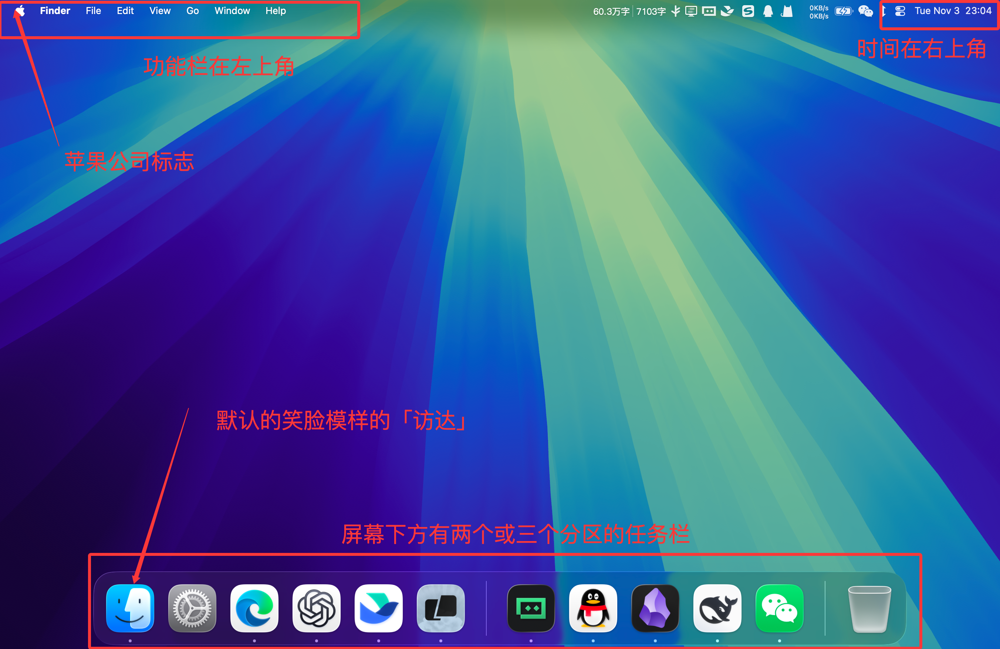
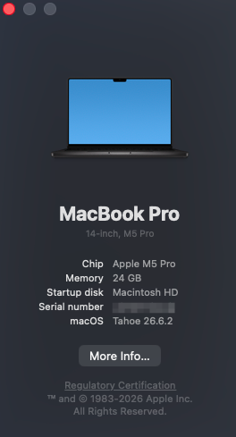
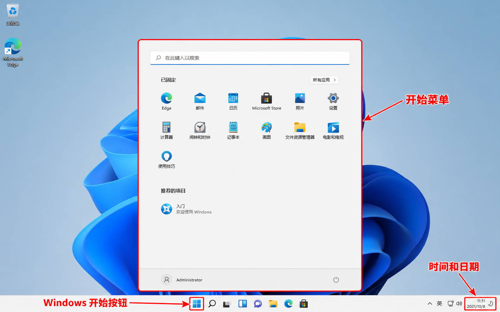

# 1.1 认识键盘与鼠标

> 键盘是计算机最早、最广泛的操作工具，编写代码、输入命令和整理笔记，都需要准确地输入文字与符号。鼠标是当前最简单且强大的操作工具，可以提供远超键盘的操作性。 本章将简单提供键盘与鼠标的操作指南资料，帮助你熟悉计算机基本的操作。

## 如何判断你的电脑类型

在开始所有学习之前，首先需要判断你的电脑系统是什么。接下来**基于笔者的一般经验**介绍几个较为简单的方式判断：
1. 如果**近期购买**的「是苹果电脑」，那么一定是 MacOS。
2. 如果购买的「是旧型号苹果电脑」，则有可能安装了 Windows 系统，建议按下文两特征进行区分。
3. 购买的「不是苹果电脑」，且「不是华为电脑」，则绝大概率是 Windows。
4. 购买的「是华为电脑」，则可能是 Windows 或 鸿蒙系统，建议咨询销售或截图桌面咨询。

> 请注意：当前鸿蒙系统因适配问题，后文提到的学习工具可能不兼容或无法使用。

MacOS 的典型特征：

点击左上角苹果标志后，可以查看系统信息，如下所示：

> 请注意，打开系统信息后，会展示「序列号(Serial Number, 也叫 SN 码)」，这是电脑的唯一标识符，也可以用于判断你的电脑是否是苹果电脑。非苹果官方主动要求提供该信息外，不建议将其泄漏。

Windows 的典型特征：

## 本节目标

1. **认识键盘**：字母与数字区、功能键、方向键，以及部分键盘上的数字小键盘。结合自己键盘的布局认识按键。
2. **认识常用按键**：Enter／Return、空格、Tab、Shift、Ctrl、Alt／Option、Command、Esc、Backspace 和 Delete；了解单独按下与组合使用的区别。
3. **切换输入状态**：中文与英文输入、大小写、全角与半角、中英文标点；认识输入法候选框和当前输入状态。
4. **输入常见代码符号**：圆括号、方括号、花括号、单引号、双引号、反引号、冒号、分号，以及正斜杠 `/` 和反斜杠 `\`。留意外观相近的中文标点与英文符号。
5. **使用鼠标**：单击、双击、右键菜单、滚动、拖动、选择文字。
6. **熟悉常用快捷操作**：复制、剪切、粘贴、全选、撤销、保存、查找和切换窗口。

## 去哪里学

- **Windows 入门教程（视频、Bilibili）:** [Windows 入门教程](https://www.bilibili.com/video/BV1VV4y1U7Kn) P1-P10
- **全尺寸键盘介绍（网站、互动式）:** [键盘键位图](https://keyboard-test.cn/tools/typing/keyboard-layout)
- **MacOS 入门介绍（视频、Bilibili）**：[MacOS 入门教程](https://www.bilibili.com/video/BV1KH4y1y7p5?) 请注意：MacOS 的操作不适用于 Windows，如果你确定你购买的是「苹果电脑」，再参考本教程。

其他参考资料：

- **Windows 官方资料**：[Windows 中的键盘快捷方式](https://support.microsoft.com/zh-cn/accessibility/windows/keyboard-shortcuts-in-windows)。微软（Microsoft，Windows 开发公司）提供的键盘快捷方式介绍，可以先忽略「Windows Copilot 键盘快捷方式」章节。
- **微软简体输入法教程**：[「Microsoft 简体中文输入法」](https://support.microsoft.com/zh-cn/windows/hardware/input-devices/microsoft-simplified-chinese-ime)用于查阅输入状态与标点切换。
- **Windows 鼠标补充**：[Microsoft「更改鼠标设置」](https://support.microsoft.com/zh-cn/windows/hardware/input-devices/change-mouse-settings)。按需查看主按钮、双击速度和滚动设置。
- **Mac 主要资料**：[Apple「Mac 键盘快捷键」](https://support.apple.com/zh-cn/102650)。先认识修饰键，再读剪切、拷贝、粘贴与常用快捷键。触控板操作可在 [《Mac 使用手册》](https://support.apple.com/zh-hans/guide/mac-help/welcome/mac)的「键盘和触控板」部分查阅。
